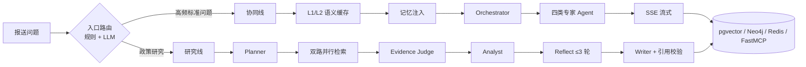

# 项目三：ReportAgent

一次选线，线内并行。日常报送有两类活：高频口径咨询要秒回，政策研究要查得全、引得住。



## 研究线七节点

意图分流 → Planner 拆 3-4 个子问题 → 双路并行检索（监管发文 / 行内口径）→ Evidence Judge
（过滤、去重、冲突检测、信源标注）→ Analyst 自检 → Reflect 补搜（≤3 轮）→ Writer 成稿 + 逐条引用校验。

**规划与执行解耦**：Planner 只产出子问题，执行阶段不重新规划，避免长链路越跑越偏。

## 关键实现

- **语义缓存**：L1 精确哈希、L2 向量相似（阈值 0.95），且只缓存**人工审核过**的标准答案。
- **分层记忆**：Redis 滑动窗口存短期会话，超阈值自动压缩摘要；PostgreSQL + pgvector 存长期偏好。
- **混合检索**：pgvector 管语义，Neo4j 管字段口径与勾稽关系；Cypher 生成失败降级关键词检索，查询不中断。
- **冲突打标**：监管与行内口径不一致时显式标记，不合并成一个"看起来正确"的答案。
- **MCP 工具**：口径检索、制度查询、只读查数、材料生成统一封装，工具与 Agent 解耦。

## 代码结构

```
ra/state.py       # 全局 State（LangGraph 节点共享）
ra/nodes.py       # 七个节点 + 协同线节点
ra/graph.py       # LangGraph 状态图与条件边（反思循环）
ra/evidence.py    # 证据过滤、去重、冲突检测
ra/cache.py       # 两级语义缓存（仅审核过的答案可命中）
ra/memory.py      # 分层记忆与摘要压缩
ra/retrieval.py   # 双路检索 + 图谱容错闭环
ra/mcp_server.py  # FastMCP 工具服务
ra/api.py         # FastAPI + SSE
```

## 运行

```bash
PYTHONPATH=report_agent python -m ra.demo          # 离线跑通研究线七节点
uvicorn ra.api:app --app-dir .                     # SSE 接口
PYTHONPATH=report_agent python -m ra.mcp_server    # MCP 工具服务
```

## 效果

缓存命中首字响应 3.2s → 80ms；单条校验建议 45 分钟 → 15 秒；研究报告引用准确率约 94%；
端到端从小时级缩短到半小时内。
